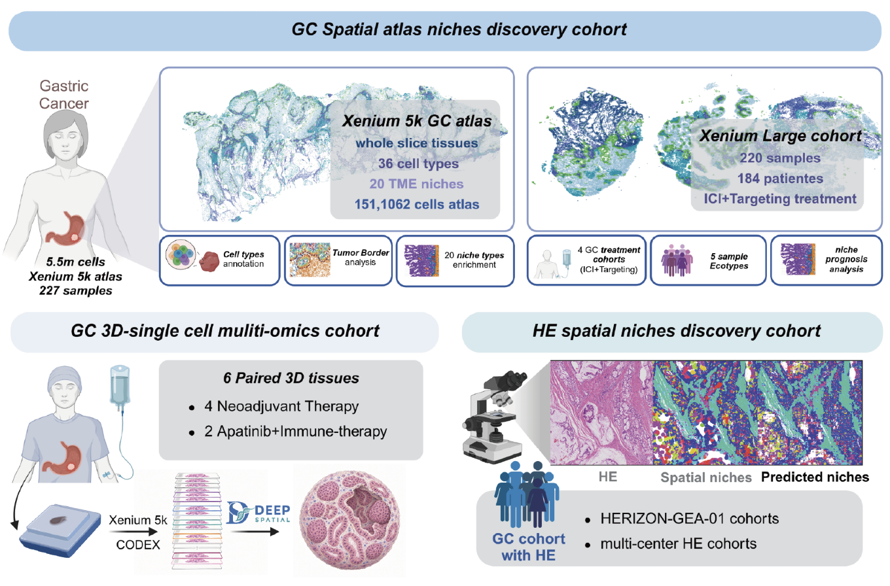

# spaGC

spaGC provides the implementation code for the paper **“Multiscale spatial
phenotypes of gastric cancer link molecular tissue organization to clinical pathology”**.



```text
spaGC/
├── spagc/                  # Python implementation
│   ├── spatial/
│   ├── histology/
│   └── reconstruction/
├── notebooks/              # Workflow entry points
│   ├── 01_domain_discovery/
│   ├── 02_he_prediction/
│   └── 03_3d/
├── README.md
├── overview.png            # Study overview
├── LICENSE
├── environment.yml
├── requirements.txt
├── constraints.txt
├── pyproject.toml
└── MANIFEST.in
```

## Installation

The reference environment uses Linux, Python 3.10 and PyTorch 2.8. An NVIDIA GPU
is recommended for training and histology feature extraction.

From the repository root:

```bash
conda env create -f environment.yml
conda activate spagc

python -m pip install torch==2.8.0 torchvision==0.23.0 \
  --index-url https://download.pytorch.org/whl/cu126
python -m pip install -r requirements.txt
python -m pip install -e . --no-deps --no-build-isolation
python -m ipykernel install --sys-prefix --name spagc --display-name "Python (spagc)"
```

For CPU execution, replace the PyTorch index URL with
`https://download.pytorch.org/whl/cpu`.

`environment.yml` supplies Python and native image libraries. `requirements.txt`
and `constraints.txt` specify the Python dependency versions. Check the
installation with `python -m pip check`.

Spatial-to-H&E registration additionally requires
[GALA](https://github.com/TaoDING2/GALA) in the same environment. An
[installation compatibility patch](notebooks/02_he_prediction/gala-compatibility.patch)
is included for its package layout and dependency declarations.

## Data and models

Study data and fitted study models are not distributed with this repository.
Prepare compatible inputs and edit the paths and parameters in each notebook.

| Workflow | Required inputs |
| --- | --- |
| Spatial discovery | Cell-by-gene AnnData with unique cell/gene IDs, `obs['batch']`, `obs['core_id']` and physical XY in `obsm['spatial']`. A new scVI fit requires raw counts in `layers['counts']`; an existing `obsm['X_scVI']` may be reused. |
| H&E prediction | Matched images and aligned cell annotations, shared niche/domain label rasters, and CTransPath feature caches. Each slide record declares its file paths, native image size and label shape. |
| Serial-section reconstruction | At least two measured anchor AnnData objects with matching gene order, registered XY, physical depth and section IDs; native H&E images with masks, calibration and saved registration transforms. |

Pretrained image-encoder weights are not included. Obtain them from the original
providers and set their local checkpoint paths in the notebooks:

| Encoder | Source |
| --- | --- |
| CTransPath | [TransPath](https://github.com/Xiyue-Wang/TransPath) |
| UNI2-h | [MahmoodLab/UNI2-h](https://huggingface.co/MahmoodLab/UNI2-h) |

Obtain weights under their providers' access and usage terms. The workflows load
local checkpoints and do not download data or weights.

## Running the workflows

```bash
conda activate spagc
export SPAGC_RUN_ID=my_run
export SPAGC_DEVICE=cuda:0  # or cpu
jupyter lab
```

Select **Python (spagc)** and execute notebooks from top to bottom. Keep the same
run ID across sequential steps of one workflow; use a new ID for a new experiment.

| Directory | Processing order |
| --- | --- |
| [01_domain_discovery](notebooks/01_domain_discovery/) | Molecular embedding → niche discovery → domain discovery → label transfer → specimen ecotyping |
| [02_he_prediction](notebooks/02_he_prediction/) | Alignment → training labels → CTransPath features → training → inference/evaluation → specimen clustering. Notebook 07 performs leave-out evaluation. |
| [03_3d](notebooks/03_3d/) | Coordinate checks → UNI2-h features → transport and paths → flow matching → reconstruction → annotation → interactive 3D export |

Existing aligned cells, labels or feature caches can be used by setting their
paths explicitly. Reconstruction annotation requires a compatible reference
PCA/classifier bundle from label transfer.

Outputs are saved under `outputs/<workflow>/<RUN_ID>/`. Local data, models and
execution outputs are excluded from version control.

## Notes

- The original H&E niche-to-domain label conversion requires one domain per niche
  and rejects ambiguous mappings. Use the declared existing domain-label rasters
  for training when this assumption does not hold.
- H&E evaluation is slide-level unless patient identities are supplied. Set
  `SPAGC_SAMPLE_METADATA` to a CSV with `name,patient_id` and optional `centre_id`
  to check patient overlap and group leave-out folds by patient.
- Curated biological labels require matching reference models. Reconstruction
  outputs are predicted molecular states; physical section depth is not biological
  time.

Full reproduction requires the original data, model artifacts and experimental
settings. The supplied environment covers `spagc/` and `notebooks/`.

## License and acknowledgements

spaGC is released under the [MIT License](LICENSE). External data and model weights
retain their own licensing terms.

This work uses [CellCharter](https://github.com/CSOgroup/cellcharter),
[scvi-tools](https://github.com/scverse/scvi-tools),
[Squidpy](https://github.com/scverse/squidpy),
[Scanpy](https://github.com/scverse/scanpy),
[GALA](https://github.com/TaoDING2/GALA),
[CTransPath](https://github.com/Xiyue-Wang/TransPath),
[DeepSpatial](https://github.com/yyh030806/DeepSpatial) and
[UNI2-h](https://huggingface.co/MahmoodLab/UNI2-h).
